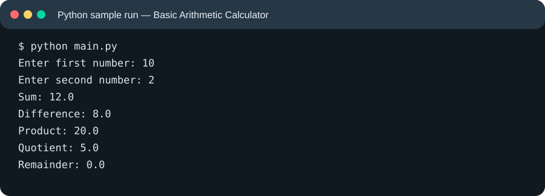
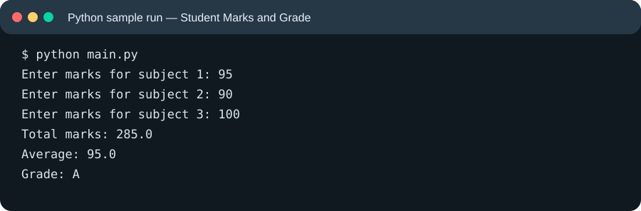
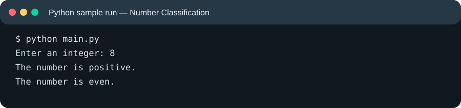
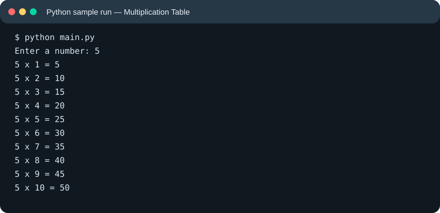
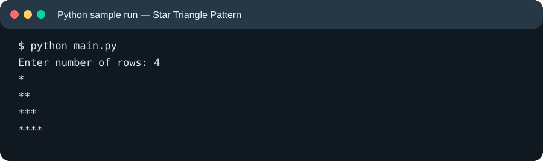
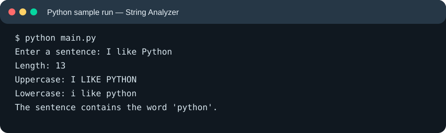
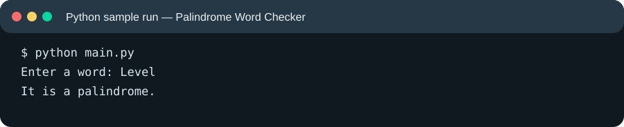
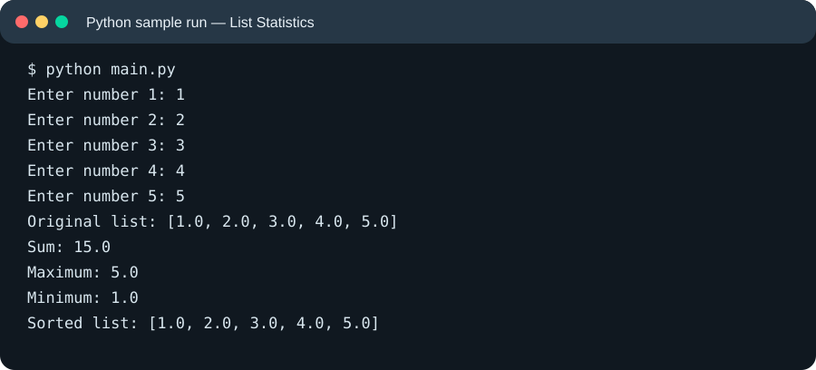
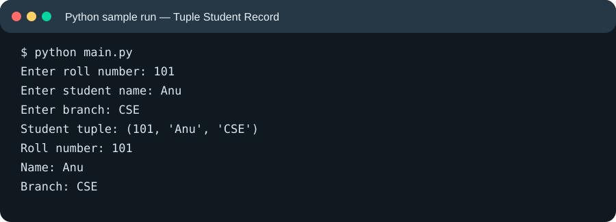
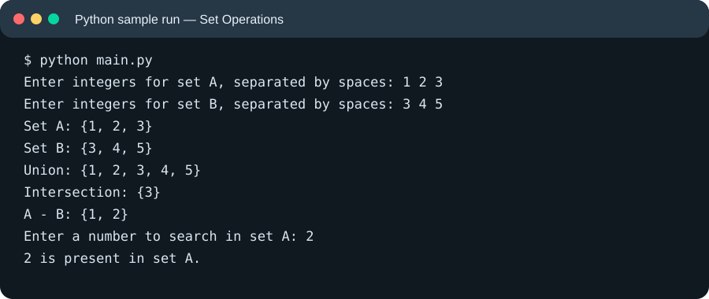

# Python Activity-Based Learning — Sample Runs

These are **generated sample-run illustrations** showing example terminal output. They are not photographs or screenshots captured from a running Python program.

## 1. Basic Arithmetic Calculator

[Open image file](01_Basic_Arithmetic_Calculator_sample_run.svg)

## 2. Student Marks and Grade

[Open image file](02_Student_Marks_and_Grade_sample_run.svg)

## 3. Number Classification

[Open image file](03_Number_Classification_sample_run.svg)

## 4. Multiplication Table

[Open image file](04_Multiplication_Table_sample_run.svg)

## 5. Star Triangle Pattern

[Open image file](05_Star_Triangle_Pattern_sample_run.svg)

## 6. String Analyzer

[Open image file](06_String_Analyzer_sample_run.svg)

## 7. Palindrome Word Checker

[Open image file](07_Palindrome_Word_Checker_sample_run.svg)

## 8. List Statistics

[Open image file](08_List_Statistics_sample_run.svg)

## 9. Tuple Student Record

[Open image file](09_Tuple_Student_Record_sample_run.svg)

## 10. Set Operations

[Open image file](10_Set_Operations_sample_run.svg)
